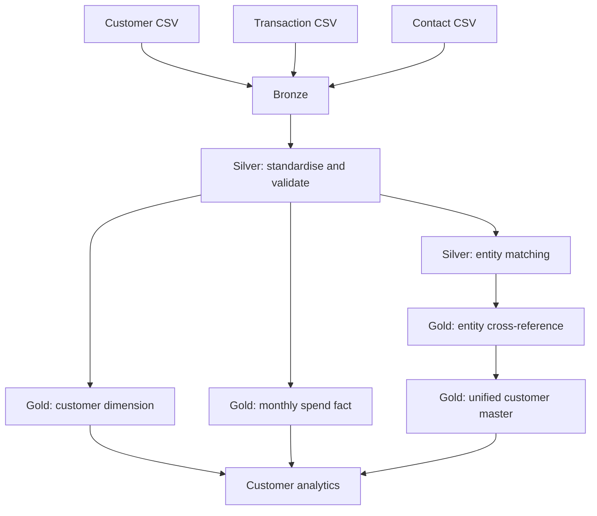

# Customer Data Unification & Lakehouse Engineering

A Microsoft Fabric data engineering project that combines customer, transaction and contact data into trusted Lakehouse tables. The solution uses a medallion architecture, PySpark transformations, Delta Lake storage and rule-based entity resolution.

## Project capabilities

- Ingest raw customer, transaction and contact data into Bronze.
- Standardise, validate and deduplicate records in Silver.
- Build curated customer and monthly transaction outputs in Gold.
- Identify possible cross-system customer matches and create unified entity records.
- Preserve source identifiers and matching reasons for traceability.

## Technology

Microsoft Fabric · OneLake · Lakehouse · PySpark · Apache Spark · Delta Lake · Spark SQL · Python

## Architecture



## Repository structure

```text
customer-data-unification-lakehouse/
├── data/
│   └── landing/                 # Synthetic source CSV files
├── notebooks/
│   └── 01_customer_data_foundation.py
├── src/
│   └── common/                  # Reusable helpers (to be added)
├── tests/                       # Data and transformation tests (to be added)
├── docs/
│   ├── architecture.md
│   └── implementation-plan.md
└── README.md
```

## Run in Microsoft Fabric

1. Create a Fabric workspace and a Lakehouse.
2. Attach the Lakehouse as the default Lakehouse for a new Fabric notebook.
3. Upload the three CSV files from `data/landing/` to the Lakehouse path `Files/landing/`.
4. Open `notebooks/01_customer_data_foundation.py` and create notebook cells from the `# COMMAND ----------` markers. Lines prefixed with `# MAGIC %md` are markdown-cell content.
5. Run the notebook from top to bottom.
6. Review the `customer360.bronze`, `customer360.silver` and `customer360.gold` schemas.

## Data

The included CSV files are synthetic demonstration data. They contain intentional variations and quality issues to exercise standardisation, validation, duplicate handling and record matching.

## Implementation roadmap

1. Foundation: Bronze, Silver, Gold and initial entity resolution.
2. Reliability: incremental ingestion, data quality quarantine and pipeline audit.
3. Customer history: SCD Type 2 and customer 360.
4. Analytics: RFM segmentation, cohorts, retention and lifetime value.
5. Matching enhancements: confidence scoring, explanations and manual review.
6. Engineering quality: automated tests, performance checks and operational documentation.
