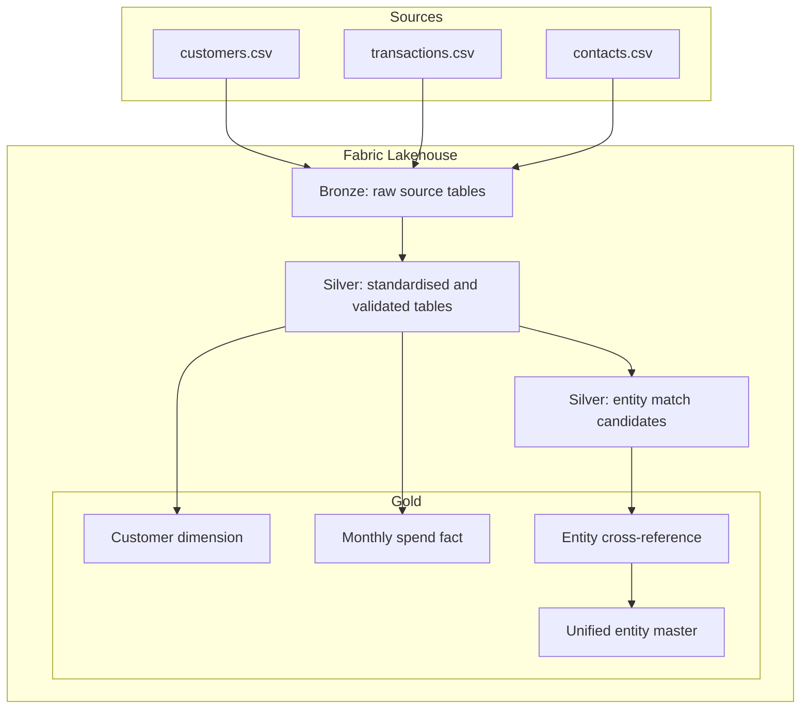

# Architecture

## Current foundation

## Planned extensions

- Watermark-controlled incremental ingestion and Delta MERGE.
- Quarantine tables and reusable data quality rules.
- SCD Type 2 customer dimension.
- RFM, cohort, retention and customer lifetime value analytics.
- Entity match confidence bands and manual review workflow.
- Pipeline audit and run-level operational metrics.
